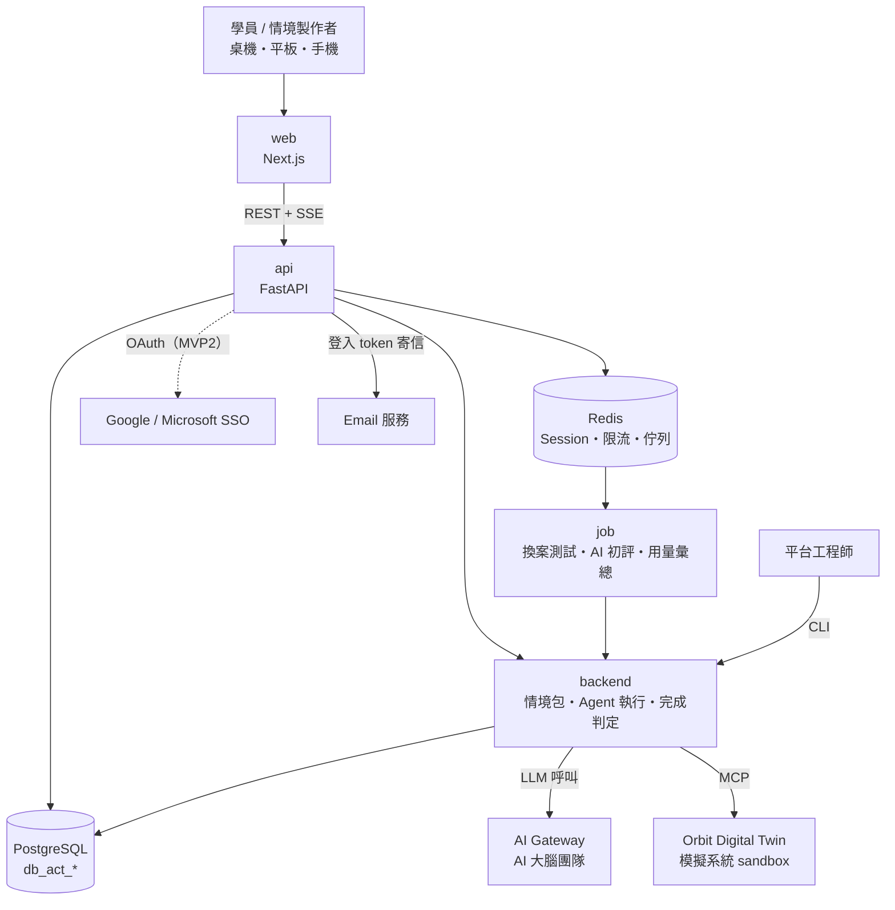

# 系統架構 — AgentCraft（代理工坊）

> 初版藍圖，實作前依 Layer 1 的 ADR 修正。標「待確認」處見 `docs/TODO.md` 啟動前待辦。

## 全景圖

**重點約束**
- LLM 一律經 AI Gateway，不直連模型供應商。
- Agent 只碰 Digital Twin 的模擬系統（sandbox），與真實系統隔離。
- Agent 執行位置（backend 內嵌 vs Agent 平台團隊的 Pod，對應 `需求/17.png` 的「個人 Agent Runtime」）**待確認**，見 ADR-001；MVP3 目標為 2027/05 正式上線後累計到年底 10 萬人次，須先確認同時並行數與每次使用的 Agent 輪次，再評估是否需要一人一 Pod。

## Layer 驗收狀態

| Layer | 名稱 | UC 範圍 | 狀態 |
| ----- | ---- | ------- | ---- |
| 1 | 基礎建設與資料層 | UC-ACT 3.1.x | ⏳ |
| 2 | 身分與帳號（邀請碼 + email token 登入；SSO 移 MVP2） | UC-ACT 3.2.1、3.3.1、3.4.1.1、4.3.3 | ⏳ |
| 3 | 情境包與 Digital Twin 串接 | UC-ACT 3.3.2、3.4.2、4.1.x | ⏳ |
| 4 | Agent、完成判定與學習紀錄 | UC-ACT 3.3.3–3.3.5、3.4.3、3.4.4、3.5.1、3.5.3、4.2.x | ⏳ |
| 5 | 學員練習 Web（P1–P7） | UC-ACT 3.2.2–3.2.6、3.2.8 | ⏳ |
| 6 | 安全、營運與用量 | UC-ACT 3.3.7、3.4.1.2、3.5.2、5.1 | ⏳ |
| 7 | Scenario Studio（MVP2，待確認） | UC-ACT 3.2.7、3.3.6、3.5.4 | ⏳ |
| 8 | 端對端整合測試 | UC-ACT 5.2 | ⏳ |

## 資料 Schema

[待 Layer 1 DDL 確認後補充。預期核心實體：組織、使用者、邀請碼、情境、案件、對話、Skill、換案測試、學習紀錄、用量。所有主要業務表帶組織歸屬與標準 8 欄。]
