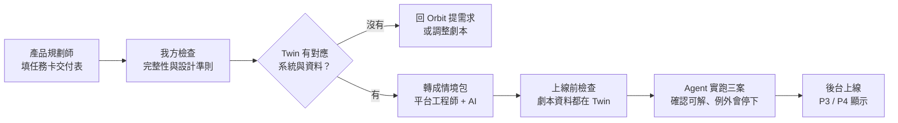

# 情境與任務卡：運作方式、交付流程與資料表

> 版本：v0.1 草稿 ／ 日期：2026-10-24
> 讀者：PM/SA、SD/PG（我方團隊），以及要交付情境的產品規劃師。
> 依據：POC 的 `docs/ADDING_SCENARIOS.md`、`scenarios/med-01-outpatient-change/` 實際檔案（scenario / policies / judge / skill / systems / cases）、任務卡 v5、PRD 00。
> **限制**：我只細讀了 med-01 一個情境包；med-02、med-03、mfg-01 與 Orbit 提供的任務卡格式可能不同，以實物為準。
> 空白交付表在 [`templates/SCENARIO-TASKCARD-TEMPLATE.md`](templates/SCENARIO-TASKCARD-TEMPLATE.md)。

## 1. 學員到底在玩什麼（以 med-01 為例）

**情境**：「門診異動的跨系統協調」。你是門診行政協調人員，A 醫師請假，3 位病患的門診受影響。

| 步驟 | 學員做什麼 | 系統做什麼 |
| ---- | ---------- | ---------- |
| 第一關・交代任務 | 用自然語言叫 Agent 查明 3 位病患狀況，提出聯絡與處理方案 | Agent 查「請假與案件資料、排班、掛號、規則庫、聯絡平台」等**模擬系統** |
| 看方案、按同意 | 看「對象 / 動作 / 選項 / 條件」，按**同意 / 不同意 / 修改** | 同意前，Agent 不能聯絡病患、不能改掛 |
| Agent 執行 | 等待；途中可能出現**情境事件**（例如病患改變主意），由學員決定怎麼處理 | Agent 打電話（由環境扮演病患回覆）、改掛、發簡訊、建立交接 |
| 提交案件報告 | 核對 Agent 整理的報告再提交 | 系統**看模擬系統的實際結果**判定完成，不看 Agent 說了什麼 |
| 第二關・寫成 Skill | 把處理方法寫成 Skill（六個欄位，不能寫死第一關的人名與日期） | — |
| 換案驗證 | 用「一般新案」「例外新案」測試 Skill，兩案都通過才算完成 | 用新資料、新對話重跑，不帶入第一關答案 |

重點：**學員不寫程式，學的是「怎麼指揮 Agent、怎麼判斷方案、怎麼把方法寫成可重用的 Skill」。**

## 2. 一個「情境」包含什麼

POC 把一個情境做成一包檔案。交付給我方時，**產品規劃師只要負責左欄的「內容」**，右欄是我方或 Orbit 的工作。

| 內容（產品規劃師提供） | 對應 POC 檔案 | 說明 |
| ---------------------- | ------------- | ---- |
| 情境卡資訊 | `scenario.yaml` | 名稱、產業、摘要、類型、預估時間、練習重點（顯示在 P3 / P4） |
| 學員任務卡（完整＋短版） | `task_card.md`、`task_card_brief.md` | 任務、怎樣算完成、怎麼做、Agent 的界線 |
| 要用到的模擬系統與工具 | `systems/*.yaml` | 每個系統有哪些查詢 / 操作、哪些寫入類需要學員方案確認 |
| 三組案件 | `cases/original / general / exception` | 原案（第一關）、一般新案、例外新案（換案測試） |
| 規則（只寫條件） | `policies.yaml` | Agent 查得到的院內 / 公司規則條文 |
| 完成判定與提示 | `judge.yaml` | 每案每個對象的**預期結果類型**、被擋下時的提示文字 |
| Skill 欄位提示 | `skill.yaml` | 六欄各自「請你寫清楚」的提示 |
| Agent 設定 | `agent.yaml` | Starter Agent 的系統提示（固定，學員不能改） |

> **本案和 POC 的重大差異**：POC 的模擬系統與資料是自己做的（`simulator/` 與 `cases/*.json`）；**production 改由 Orbit 的 Digital Twin 提供**，情境包**不自帶資料，只引用 Twin 裡的資料**，而且劇本提到的人事物必須在 Twin 找得到（PRD 00 §8.1）。所以交付表不要求產品規劃師寫 JSON 資料，而是列出「需要 Twin 提供哪些系統與哪些資料」。

## 3. 好情境的設計準則（POC 踩過的坑，交付時要遵守）

來自 POC `ADDING_SCENARIOS.md`「設計教訓」，交付表已把它們變成必填欄位：

1. **規則只寫條件，不寫怎麼處理。** 處理方法留給學員的 Skill；否則 Agent 不用 Skill 就全過，分不出 Skill 好壞。
2. **要有「Agent 做得不夠好、系統卻不擋」的情況**，學員才有東西可改進。
3. **學員至少做 2 個有後果的選擇**（選項各有利弊、規則沒定答案、會改變系統結果）；只改措辭不算。
4. **途中消息要在發生的模擬時間讓學員看到**，並暫停 Agent。
5. **每件會等待的事都要有結局與期限**（核准、送達、交接、稍後再撥）。
6. **預期結果要能從規則推出來**；規則式評分只看明確事實，不比對 Agent 寫的文字。
7. **案件三組各自命名**：原案、一般新案、例外新案；用「主題 × 案件 × 對象」覆蓋表確保每個驗證主題至少練到一次。
8. **學員看到的文字要短、具體、以 Agent 為主詞**，不用抽象名詞。

## 4. 交付流程（建議）

- **誰轉情境包**：PRD 指「平台工程師」，用 AI 協助。是否由我方（SD/PG）擔任，**待確認**。
- 沒有通過「上線前檢查」不能上線；情境更新產生新版本，已開始的練習留在舊版。

## 5. 對資料表的影響（初步估計）

**不要把一個情境拆成十幾張表。** 情境包內容異質（各情境的系統、規則、案件格式都不同），建議：**以「版本化的文件」儲存，只把查詢需要的欄位獨立成欄。**

### 5.1 情境相關（建議）

| 資料表 | 用途 | 備註 |
| ------ | ---- | ---- |
| `act_scenario` | 情境主檔：代號（如 `med-01`，定了不改）、產業、狀態（製作中 / 上線 / 下線）、目前版本 | 後台上下線 |
| `act_scenario_version` | 每個版本一筆：情境包完整內容（JSON 文件）、版本號、檢查結果、發布時間 | 更新＝新版本；練習綁定開始時的版本 |
| `act_scenario_case` | 三組案件（原案 / 一般 / 例外）及其引用的 Twin 資料編號 | 可併入版本文件，視查詢需求 |
| `act_industry` | 產業清單與顯示順序 | 可先用設定檔 |

### 5.2 全系統資料表概估（約 20 張，MVP1 約 14 張）

| 領域 | 資料表 | MVP1 |
| ---- | ------ | ---- |
| 身分 | `act_org`、`act_user`、`act_user_role`、`act_invite`、`act_login_token` | ✅ |
| 寄信 | `act_mail_outbox` | ✅ |
| 情境 | `act_scenario`、`act_scenario_version` | ✅ |
| 練習 | `act_case_run`（一次練習）、`act_case_message`（對話）、`act_case_plan`（方案與同意）、`act_case_action`（工具呼叫紀錄）、`act_case_report`（案件報告） | ✅ |
| Skill | `act_skill`、`act_skill_version` | ✅ |
| 換案測試 | `act_swap_test` | ✅ |
| 學習狀態 | 由事件推導，可不獨立成表 | — |
| 用量與計量 | `act_usage_daily`、`act_llm_call`（token 計量，Schema 先預留） | 預留 |
| 稽核 | `act_audit_log` | 預留 |
| 後台 | Seat、Credits、模型目錄等（見 SITEMAP §3） | MVP2 以後 |

> 所有主要業務表依專案規範帶標準 8 欄與組織歸屬；log 類表只帶 `create_*`。**確切張數待 Layer 1 定案**，上表只是規模概念。

## 6. 待確認

| 編號 | 問題 | 對象 |
| ---- | ---- | ---- |
| S-1 | Orbit 提供的任務卡格式是否與 POC 的 v5 一致？能否先給一份實物？ | 產品規劃 / Orbit |
| S-2 | Twin 如何為每位學員提供獨立 sandbox 與重設？案件的「初始資料」放在 Twin 還是情境包？ | Orbit |
| S-3 | 哪些系統與工具 Twin 已有（目前只有醫療業）？工具的介面規格 | Orbit |
| S-4 | 情境包轉換由誰做、AI 協助流程是否沿用 POC 的 `validate_scenario` 檢查 | 產品規劃 / 我方 |
| S-5 | 「約 60 個情境」的真實數量與交付時程（POC 站台只開 3 個） | 產品規劃 |
| S-6 | 情境事件（途中消息）與規則式判定是否都要由產品規劃師在表內定義，還是由平台工程師補 | 產品規劃 / 我方 |
