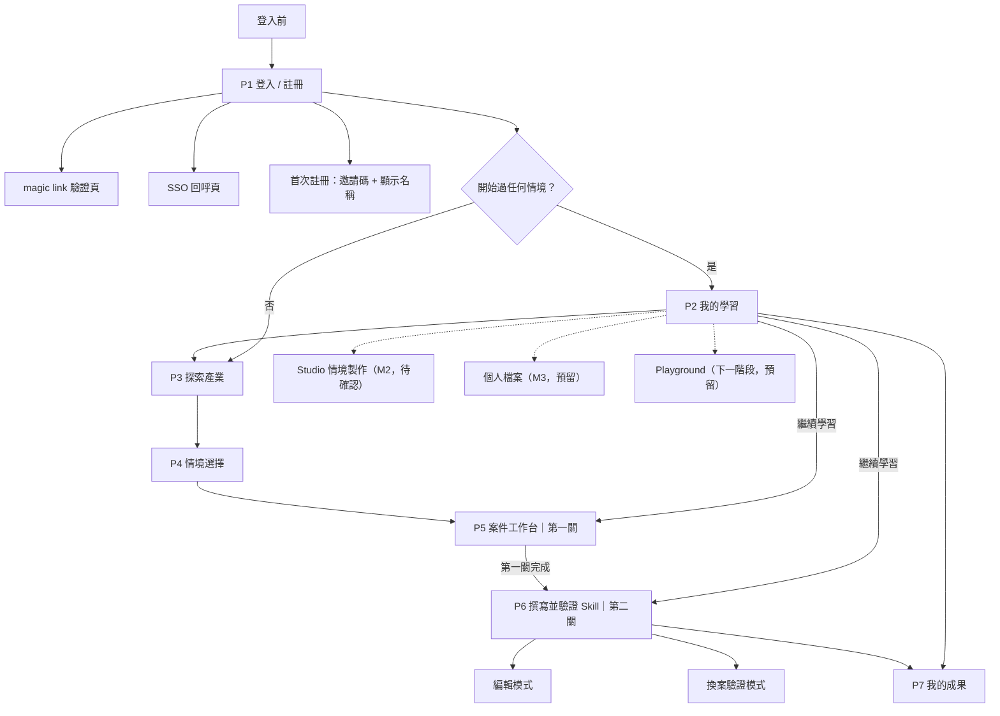
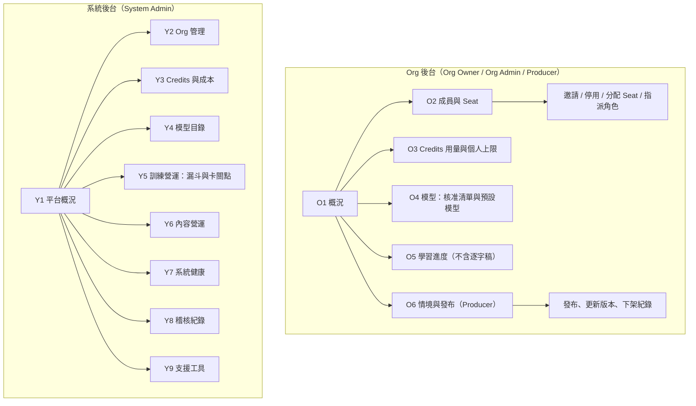

# Site Map — AgentCraft（代理工坊）前台與後台

> 版本：v0.1 草稿 ／ 日期：2026-10-24 ／ 狀態：待確認
> 基準：POC `AIP_Education_Sitemap_IA_v3`（P1–P7）、POC PRD 00 與 PRD_PLAN、`需求/17.png`（Citizen Portal 職責）。
> 與 POC 不同處以「**本案新增**」標示。路徑（URL）為建議值，Layer 5 開始前再定案。
> 階段：**M1** = MVP1（2026/11 底，300 人）｜**M2** = MVP2（2027/03 底）｜**M3** = 正式版（2027/05 上線，年底累計 10 萬人次）

---

## 1. 角色與入口

| 角色 | 是誰 | 入口 | MVP1 | 備註 |
| ---- | ---- | ---- | ---- | ---- |
| 訪客 | 未登入者 | 登入頁 | ✅ | 只看得到登入 / 註冊 |
| 學員 | Level 1 第一線人員 | 前台 | ✅ | 與情境製作者同一種帳號 |
| 情境製作者 | 用 Studio 做情境的人 | 前台 Studio | M2（待確認） | MVP1 規格上所有登入者都能進，無權限區分 |
| 平台工程師 | 營運工程人員 | **CLI，無畫面** | ✅ | 邀請碼、用量上限、demo 帳號、情境上線 |
| System Admin / Org Owner / Org Admin / Producer | 管理端使用者 | 系統後台 / Org 後台 | M2–M3 | 角色定義見 §3.2（POC 提案討論版） |

---

## 2. 前台（學員端）

### 2.1 頁面結構

**共用規則**：頁型共用、情境內容不同；第一關完成前 P6 不可進入；隨時可在 P2 / P3 / P7 之間切換；進行中情境可在 P5 / P6 間切換。

### 2.2 頁面清單

| 代號 | 頁面 | 建議路徑 | 目的 | 階段 | 對應 UC |
| ---- | ---- | -------- | ---- | ---- | ------- |
| P1 | 登入 / 註冊 | `/login` | **MVP1：邀請碼 + email 驗證 → 寄 token 到信箱 → 登入**；Google / Microsoft SSO 後移（M2，待確認）；首次註冊輸入邀請碼與顯示名稱 | M1 | 3.2.1、3.3.1 |
| P1a | magic link 驗證 | `/auth/verify` | 驗證連結，過期 / 已使用給繁中說明 | M1 | 3.3.1.1 |
| P1b | SSO 回呼 | `/auth/callback/{provider}` | 處理授權結果；取消或失敗回 P1 | M2（MVP1 不做） | 4.3.1、4.3.2 |
| P1c | 首次註冊 | `/signup` | 邀請碼 + 顯示名稱；註冊後不能改名（M3 個人檔案才能改） | M1 | 3.3.1.2 |
| P2 | 我的學習 | `/learning` | 進行中 / 待修正 / 已完成 / 下一步；**尚未開始任何情境者直接到 P3** | M1 | 3.2.2、3.3.5 |
| P3 | 探索產業 | `/explore` | 產業卡片；無情境者顯示「準備中」不可開；企業共通情境列最後 | M1 | 3.2.3、3.3.2 |
| P4 | 情境選擇 | `/explore/{industry}` | 任務摘要、練習重點、預估時間、個人狀態、開始 / 繼續 | M1 | 3.2.3 |
| P5 | 案件工作台（第一關） | `/scenarios/{code}/work` | 任務與限制 / Agent 對話 / 模擬系統三區；方案確認；提交案件報告；重設本案 | M1 | 3.2.4、3.3.3 |
| P6 | 撰寫並驗證 Skill（第二關） | `/scenarios/{code}/skill` | 編輯模式與換案驗證模式；版本、啟用；一般新案 + 例外新案 | M1 | 3.2.5、3.3.4 |
| P7 | 我的成果 | `/results` | 案件報告、Skill 最終版、換案紀錄；只顯示當前有效版本，舊版在詳情 | M1 | 3.2.6 |
| S1 | Studio 情境製作 | `/studio` | 用對話做任務卡、轉情境包、發布前檢查、自己試用 | M2（待確認） | 3.2.7、3.3.6 |
| — | 使用導覽 / 新手引導 | 頁內浮層 | POC 有 Guides 元件；內容待產品規劃提供 | M1（待確認） | 3.2.8 |
| — | 錯誤與空狀態 | 共用 | 404、無權限、用量用盡、Twin / LLM 不可用，全繁中 | M1 | 3.2.8 |
| — | 個人檔案 | `/profile` | 修改顯示名稱；P7 入口移到此處 | M3（預留） | — |
| — | Playground | `/playground` | 獨立入口，跟產業 agent 自由對話；只存對話不進學習紀錄 | 下一階段（預留，不實作） | — |

### 2.3 頁內內容（不另開頁）

| 所在頁 | 內容 |
| ------ | ---- |
| P2 | 繼續學習、待修正 / 待重測、已完成、探索新情境 |
| P5 | 任務卡摘要與完整內容、模擬系統資料與詳情、學習筆記、案件報告、完成提示 |
| P6 | Skill 六面向編輯、版本歷史、Markdown 檢視 / 匯出、AI 起草、換案驗證工作台、測試紀錄 |
| P7 | 成果卡與證據詳情、舊版與重測歷史 |
| 頁首（全站） | 顯示名稱、P2 / P3 / P7（M2 起加 Studio）導覽、登出；**顯示學員自己填的顯示名稱，不顯示 email** |

### 2.4 情境學習狀態（P2 / P4 共用）

沿用 POC 八態，由實際事件與證據推導，不用百分比判定：尚未開始 → 第一關進行中 → 第一關完成待寫 Skill → Skill 草稿 / 有未保存修改 → Skill 已保存待驗證 → 一般案或例外案未通過 → Skill 已改版需重測 → 兩案通過（完成）。

「繼續學習」依狀態接回 P5、P6、進行中的換案測試；已完成則到 P7。

---

## 3. 後台（管理端）

> 依據：POC `docs/proposals/AIP_Education_Org_Seat_Role_Credits_Proposal.md`（2026-10-14 **討論版**，已讀全文）。該提案明說「MVP1 本身不做管理後台」，是 MVP1 之後的版本；PRD 00 也把後台列為下一階段。
> 本節把提案轉成 Site Map。**哪些排 MVP2、哪些到正式版，待確認。**

### 3.1 設計原則（來自提案）

- **Seat 管訓練資格，Role 管管理與製作權限，Token-based Credits 管 AI 推論消耗**，三者獨立。
- 一個 User 只屬於一個 Org；各 Org 的成員、學習紀錄、情境與稽核資料彼此隔離。
- **Org Admin 看不到學員對話逐字稿**，只看進度與成果；System Admin 預設也不能讀，查問題用「以該 User 身分檢視」並留稽核紀錄。
- 學員看到的是**個人上限使用百分比**，不是 Credits 數字；通關評分是規則式，不扣 Credits，額度用完仍照常評分。

### 3.2 角色

| 角色 | 範圍 | 能做什麼 | 佔 Seat |
| ---- | ---- | -------- | ------- |
| System Admin | 平台，不屬任何 Org | 管 Org、Credits 池、模型目錄與換算比例、平台情境、稽核、支援工具 | 否 |
| Org Owner | 每個 Org 1 人 | 同 Org Admin，並可指定 Org Admin | 否 |
| Org Admin | 自己的 Org | 邀請 / 停用成員、分配 Seat、指派 Producer、調個人上限、設模型核准清單與預設模型 | 否 |
| Producer | 自己的 Org | 建立、測試、發布 / 下架自己 Org 的情境 | 否 |
| 學員（Standard Seat） | 前台 | Agent User Training（本案 Level 1） | 是 |
| 學員（Builder Seat） | 前台 | 另含 Agent Builder Training | 是 |

角色可複選，與訓練 Seat 獨立；有角色、沒 Seat 的人看不到訓練課程。

> **衝突提醒**：PRD 00 寫「Level 2 內容未決，PRD 不寫」，提案卻已有 Builder Seat 與 Builder Training。我方先**只預留 Seat 欄位與課程等級**，不做 Builder 畫面。

### 3.3 頁面結構

### 3.4 Org 後台頁面

| 代號 | 頁面 | 內容 | 使用者 | 階段 |
| ---- | ---- | ---- | ------ | ---- |
| O1 | 概況 | Standard / Builder Seat 已用 / 總數、待接受邀請（**也佔 Seat**）、Producer 人數 / 上限、本月 Credits、活躍學員 | Owner / Admin | M3 |
| O2 | 成員與 Seat | 成員清單；Seat 單選（None / Standard / Builder）、角色複選；邀請、停用；收回 Seat 保留學習紀錄 | Owner / Admin | M2 最小版 → M3 |
| O3 | Credits 與個人上限 | 個人上限調整、已用、80% 提醒；分布（依功能區 / 模型 / 人） | Admin | M3 |
| O4 | 模型 | 從平台目錄挑核准清單；Agent User Training 預設模型；即將停用通知 | Admin | M3 |
| O5 | 學習進度 | 兩條訓練分開顯示通過狀態與成果，可匯出；**不顯示對話逐字稿** | Admin | M2 → M3 |
| O6 | 情境與發布 | Org 情境清單、發布 / 更新 / 下架；需通過自動安全檢查；情境屬於 Org 不屬個人 | Producer | M3（對應 Studio 發布） |

### 3.5 系統後台頁面

| 代號 | 頁面 | 內容 | 階段 |
| ---- | ---- | ---- | ---- |
| Y1 | 平台概況 | Org 數、Seat 使用率、活躍學員、訓練成果 | M2 簡版 → M3 |
| Y2 | Org 管理 | 建立 / 停用 Org、指定 Owner、合約期間、Seat 數、Producer 上限、Credits 池、預設個人上限 | M2 最小版 |
| Y3 | Credits 與成本 | 用量（依 Org / 功能 / 模型）、實際 LLM / GPU 成本、用量異常者 | M3 |
| Y4 | 模型目錄 | 新增 / 驗證 / 停用模型、換算比例與**費率版本**、各用途預設模型 | M3 |
| Y5 | 訓練營運 | 每情境漏斗（開始 → 第一關通過 → 換案通過）、卡關點 | M3 |
| Y6 | 內容營運 | 平台與 Org 情境使用概況、發布紀錄、自動安全檢查失敗紀錄；**含情境上下線與上線前檢查結果** | M2 最小版 |
| Y7 | 系統健康 | Agent Runtime、MCP / Twin、LLM Gateway 的錯誤率與延遲 | M2 |
| Y8 | 稽核紀錄 | 只增不改：角色 / Seat 異動、上限調整、情境發布下架、以 User 身分檢視、重設密碼 | M2 起 |
| Y9 | 支援工具 | 重設密碼、重設學員案件、建立 demo 帳號、邀請碼、以 User 身分檢視 | M2（取代 CLI） |

### 3.6 分階段

| 階段 | 做法 |
| ---- | ---- |
| **M1（11 月底）** | **無畫面，CLI**：邀請碼、個別用量上限、demo 帳號、情境上線（UC 3.4.1）。PRD 規定每人每日用量上限（次數），**Credits 改 token 計算是下一階段** |
| **M2 建議** | 系統後台最小版（Y2、Y6、Y7、Y8、Y9）＋ Org 後台最小版（O2、O5）：取代 CLI、能開新 Org 與成員 |
| **M3 / 正式版** | 提案「第一版」完整範圍：Credits 池與個人上限、模型目錄與核准清單、Dashboard、Producer 發布 |

### 3.7 對 MVP1 Schema 的影響（Layer 1 要先留位置）

提案的計量與組織模型，**事後補代價很高**，建議 Layer 1 就預留，即使 MVP1 沒畫面：

| 項目 | 預留方式 |
| ---- | -------- |
| 組織歸屬 | 所有帳號與衍生資料帶 `org_id`，只有一個預設組織（與 OV-04 一致） |
| Seat 與角色 | 帳號有 Seat 欄位（預設 Standard）與角色關聯表，MVP1 不做畫面 |
| **LLM 呼叫計量** | 每次 LLM 呼叫記錄：使用者、功能區（Agent User / 初評 / AI 起草 / 模擬對象回覆 / 情境製作）、模型、input / output / cached / thinking token、費率版本。MVP1 仍可只用「次數」限額，但 token 要先記 |
| 練習綁定模型 | 一次練習開始時記下用的模型，期間不變；成果記錄用的模型 |
| 稽核紀錄表 | 只增不改的 log 表（僅 `create_*` 欄） |
| 情境版本 | 情境更新產生新版本，已開始的練習停留在原版本 |

---

## 4. 前後台共用的資料關係

| 前台動作 | 後台對應 |
| -------- | -------- |
| 邀請碼註冊 | Y9（M1 為 CLI）；M2 起 O2 成員邀請 |
| 每日用量被擋 | M1 CLI 調整；M3 起 O3 個人上限 |
| 情境在 P3 / P4 顯示或「準備中」 | Y6 情境上下線 |
| Studio 發布 | O6 Producer 發布到自己 Org |
| 所有資料歸屬組織（OV-04） | Y2 / O2；MVP1 僅預設組織，無畫面 |
| 學員成果與進度 | O5 看進度與成果，**不看逐字稿** |
| 模型選擇 | O4 設預設模型；一次練習開始時鎖定 |

---

## 5. 待確認

| 編號 | 事項 | 暫定處理 |
| ---- | ---- | -------- |
| S1 | 後台是否排 MVP2、做到哪（Y2、Y6–Y9、O2、O5 最小版？） | 先照 §3.6 建議；若縮 MVP1 範圍，後台一律不做 |
| S2 | Studio 是否 MVP2 | 先排 MVP2（Layer 7） |
| S3 | 第 5 個產業與企業共通情境在 P3 的呈現 | 沿用 POC：企業共通獨立列最後 |
| S4 | 後台角色與權限 | 採用 POC 提案 §3.2（討論版，POC 自己也標待決） |
| S9 | Level 2（Builder Seat / Training）：PRD 00 說內容未決，提案已設計 | 只預留 Seat 欄位，不做畫面 |
| S10 | Credits 計量何時從「次數」改為 token | MVP1 先記 token、限次數；改制時間待產品規劃團隊 |
| S5 | 個人檔案入口與 P7 入口調整 | M3 才做；MVP1 P7 入口在頁首 |
| S6 | 使用導覽內容與是否 MVP1 必要 | 待產品規劃團隊提供 |
| S7 | Design System（PRD 21 未寫；POC 有 `AIPDesignSystem.html`）是否沿用 | 待產品規劃團隊確認 |
| S8 | 「人次」定義，影響 Y1 / O1 看板指標 | 見 TODO |

後台頁面的 UC 尚未納入 `SDD.md`（目前 3.4.1 為 CLI）；確認排程後再補 UC，並同步調整 TASK.md。
